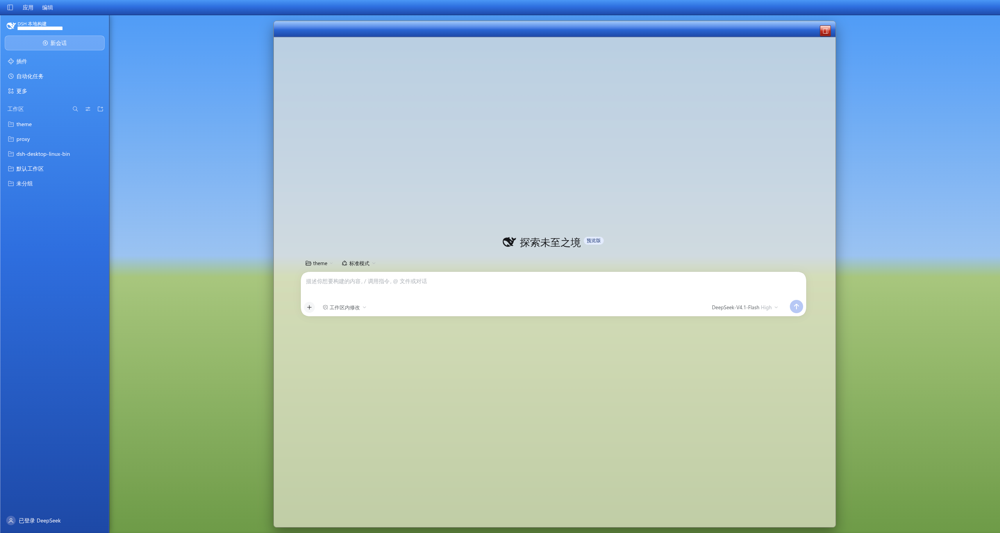
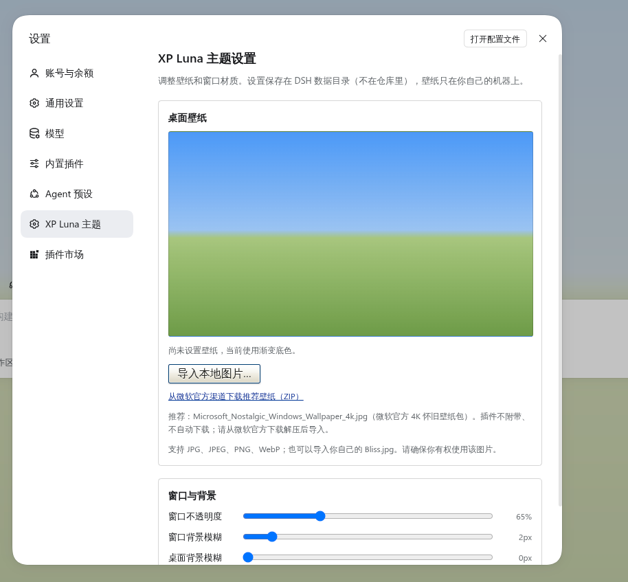

<div align="center">
  
  <h1>DSH XP Luna</h1>
  <p><b>Theme for DeepSeek Harness · DeepSeek Harness 主题</b></p>
  <p><i>Windows XP Luna, rebuilt as a skin.<br/>把 Windows XP 的 Luna 桌面，重新做回一套皮肤。</i></p>
  <p>
    <a href="#english">English</a> · <a href="#中文">简体中文</a>
  </p>
  <p>
    <a href="LICENSE"></a>
    <a href="https://github.com/BH8GCJ/dsh-xp-luna/releases/latest"></a>
    
    <a href="https://github.com/BH8GCJ/dsh-xp-luna/stargazers"></a>
  </p>
</div>

---

## English

A DeepSeek Harness theme that puts the Windows XP Luna desktop back on screen: a blue taskbar column on the left, and the conversation inside a floating XP window with a glass body and a Luna titlebar. The wallpaper is **not bundled** — import your own image from the theme's Settings page, or start from the built-in gradient.

It is not a pixel-perfect recreation — the native window frame and the system taskbar live outside the page — but it keeps what makes Luna recognisable: the beige work surface, square corners, hard shadows, opaque menus, pale-yellow tooltips, and three caption buttons in the top-right corner.

### ✨ Features

| | Feature | Notes |
|---|---|---|
| 🖼 | **Host-stored wallpaper** | Import the Microsoft 4K nostalgic wallpaper, Bliss.jpg, or any JPG/PNG/WebP from **Settings → XP Luna theme**; stored on this machine, never committed |
| 🔵 | **Luna taskbar sidebar** | Left column as a blue gradient, with text, icons and borders turned white inside it |
| 🧊 | **Glass window** | The conversation, the Plugins page and the automation tasks page are translucent beige with a light backdrop blur (`0.75` / `4px`, both tunable); other management pages stay opaque so their lists stay readable |
| 🪟 | **Luna titlebars** | The conversation header gets the glossy gradient and three XP-style caption buttons, close colour on the far-right control; the Plugins page header gets the same full-width band |
| 🖱 | **XP command buttons** | The automation tasks page's “New” button and the Plugins toolbar use the beveled Luna surface instead of flat host fills |
| 🎨 | **141 token overrides** | Beige surfaces, square corners, hard shadows, opaque menus, pale-yellow tooltips, wider scrollbars |
| 🌗 | **Light mode only** | Dark mode keeps the built-in palette; the skin removes itself when you switch |
| 🪶 | **No bundled dependencies** | Theme tokens plus one stylesheet; React comes from the host module table; the settings live on an official Settings page |

### 📸 Screenshots

| Main window | Settings page |
|---|---|
|  |  |

> The screenshots use the built-in CSS gradient, without an imported wallpaper.

### 📦 Install

**Desktop app (recommended)** — open **Plugins → Add plugin**, paste the repository address below, and confirm. The app installs into its own profile.

```
https://github.com/BH8GCJ/dsh-xp-luna
```

**Desktop, from the command line** — quit the app completely first: the `desktop` profile belongs to the app, and the app rewrites it on exit. `--profile` must come before the pnpm arguments.

```sh
dsh plugin --profile desktop add github:BH8GCJ/dsh-xp-luna
```

**Web / other profiles** — use the profile you actually boot:

```sh
dsh plugin --profile web add github:BH8GCJ/dsh-xp-luna
```

**Local checkout (development)** — in **Add plugin**, paste the absolute path of this directory instead. The committed `client.js` already contains the built bundle, so a fresh clone needs no build step; after editing `src/client.js`, run `node scripts/build.mjs`.

### 🖼 Wallpaper

This repository ships **no wallpaper files**. Open **Settings → XP Luna theme** to import one; the plugin starts on a neutral XP-coloured gradient until then.

The page has two parts:

- **Desktop wallpaper** — preview, **Import a local image** (JPG, JPEG, PNG or WebP), **Remove wallpaper**, and the official download link. The original file is uploaded to the local Host (never to the internet) and stored in `$DSH_HOME/.dsh-xp-luna-data/`, outside the repository. It survives app restarts and the Web UI's changing port. **Removing it deletes that stored file** and restores the gradient.
- **Window & background** — three sliders: window opacity, window blur, and desktop blur. Changes apply the moment you drag and auto-save after a short pause; there is no separate Save button. The window glass is a masked wallpaper layer plus a separately composited tint (not `backdrop-filter`), so dragging opacity does not repaint the page wallpaper. The desktop blur is its own fixed wallpaper layer (`body::before`), separate from the window layer, and blurs only the wallpaper outside the window.

**Recommended default:** `Microsoft_Nostalgic_Windows_Wallpaper_4k.jpg` from Microsoft's official 4K nostalgic wallpaper pack. Download the zip from Microsoft Design, extract the JPG, then import it on the settings page:

<https://microsoft.design/wp-content/uploads/2025/08/microsoft_nostalgic.zip>

The plugin does **not** download this file for you, does **not** bundle it, and does **not** use third-party mirrors. Public availability is not treated as permission to redistribute it.

**Custom wallpaper:** you can import the original Windows XP `Bliss.jpg` photograph or any other image you have the right to use. If the imported image is small, the page warns that it may look blurry when stretched; 1920×1080 or larger is recommended. The plugin never distributes Bliss.jpg or any other copyrighted wallpaper; supplied files remain your responsibility.

Wallpapers are third-party materials and are **not** covered by this project's MIT License. See [THIRD_PARTY_NOTICES.md](THIRD_PARTY_NOTICES.md).

> Updating from an older version? Restart the desktop app once: the wallpaper/settings routes live in the Host half and load at startup.

### 🎛 Configuration

Everything else lives in `src/client.js`; rebuild with `node scripts/build.mjs` after a change.

| What | Where | Default |
|---|---|---|
| Window opacity | **Settings → XP Luna theme** (or `--xp-window-alpha`) | `0.75` |
| Window backdrop blur | **Settings → XP Luna theme** (or `--xp-window-blur`) | `4px` |
| Desktop wallpaper blur | **Settings → XP Luna theme** (or `--xp-bg-blur`) | `0px` |
| Window width | `max-width: min(1440px, 92%)` on the window rule | — |
| Taskbar / titlebar gradients | the `taskbar` and `titlebar` `linear-gradient()` blocks | Luna blue |
| Caption buttons | the `XP caption trio` block | blue, blue, red |
| Schedule button in the header | remove the `[data-schedule-reminder-entry]` rule | hidden |
| Wallpaper | **Settings → XP Luna theme**; stored in `$DSH_HOME/.dsh-xp-luna-data/` | gradient fallback |

> The settings page is the only runtime UI the plugin adds. Everything else stays a token layer plus one stylesheet, so installing and uninstalling the theme remains clean.

### 🔍 Under the hood (for reviewers)

The client half does three things; the token layer and stylesheet only while the resolved scheme is light, the Settings page once:

1. **Token layer** — `ctx.theme.overrideTokens()` writes 141 `--dsw-*` / `--dsh-*` overrides onto `body`: palette, radii, shadows, menus, tooltips, scrollbars.
2. **Scoped stylesheet** — one plugin-owned `<style>` element for what tokens cannot express: sidebar gradient, floating window, titlebar, caption buttons, wallpaper fallback. It is removed with the plugin.
3. **Settings page** — a `settings.section` occupant with the wallpaper preview, import/remove controls and the window sliders. It talks to the Host half through same-origin routes: `GET/POST/DELETE /dsh-xp-luna/wallpaper` and `GET/POST /dsh-xp-luna/settings`. The Host stores the original image under `$DSH_HOME/.dsh-xp-luna-data/` and serves it through the route, so it survives port changes and restarts. No bundled images; the only upload target is the local Host.

Selectors use only stable host attributes, never hashed CSS-module class names:

| Selector | Meaning |
|---|---|
| `[data-shell-overlay]` | the frame; its element children are sidebar, centre, rightbar, bottom row, overlay, leading seat |
| `[data-windows-titlebar]` | Desktop caption mode (Linux and Windows) |
| `[data-conversation-header-corner]` | the header's far-right seat |
| `[data-sidebar-right-expand]` | the right-panel expand control |
| `[data-schedule-reminder-entry]` | the schedule trigger in the utility row |
| `[data-open-target]` | the open-in-app split control |

> Selectors are checked against DeepSeek Harness `0.2.x`. The token layer is the stable part; if the host renames an anchor, the affected structural rule needs an update.

### ⚠️ Known limitations

- **Not a pixel-perfect recreation.** The native window frame, the system taskbar and the Start menu are outside the page. There is no page-side IPC for minimise/maximise/close either, so the caption buttons are visual only.
- The sidebar acts as the “taskbar” and the conversation header as the “titlebar”; that is a reinterpretation of the layout, not a native XP structure.
- On a blank Session the header does not render its utility row, so the caption buttons disappear until a conversation exists.
- The glass covers the conversation, the Plugins page and the automation tasks page; other management pages (Settings, ...) keep an opaque work surface. The composer seat's beige fade is cleared so the glass shows through; the composer card, compaction and disclosure headers keep their own surfaces.
- **No wallpaper ships with the plugin.** Without an import, the desktop uses the gradient fallback; wallpapers are user-provided and must comply with their own copyright terms. Small images are stretched by `background-size: cover`; the settings page warns under 1920 px wide.
- The Host half registers the wallpaper/settings routes at startup; after upgrading the plugin, restart the desktop app once.
- **Native `<select>` popups on dark Linux desktops.** Some plugin pages (for example billion-context's version picker) use a native `<select>`. With KDE BreezeDark or GNOME `prefer-dark`, the platform popup can stay light while the plugin card is dark, so the option list is hard to read; the popup is drawn by the platform and ignores the theme CSS. Workaround: switch the desktop to a light colour scheme, or open the Web UI in a browser (the popup then follows the page's `color-scheme`). A self-drawn dropdown is planned.
- **Fully restart after an update.** The client bundle is read when Harness starts; a page refresh does not load new CSS, and the beige glass can look wrong until the app is reopened.

### 🗑 Uninstall

Disable or remove the plugin in the Plugin Manager; the stock theme comes back immediately. The imported wallpaper and settings stay in `$DSH_HOME/.dsh-xp-luna-data/`; remove the wallpaper from the settings page before uninstalling, or delete that directory. From the command line:

```sh
dsh plugin --profile desktop remove @local/dsh-xp-luna
```

---

## 中文

一个 DeepSeek Harness 主题，把 Windows XP 的 Luna 桌面重新搬回屏幕：左侧是一条蓝色任务栏，聊天界面装在一扇悬浮的 XP 窗口里——玻璃质感的窗体，配 Luna 标题栏。壁纸**不随插件附带**：在主题的设置页导入自己的图片，或者先用内置渐变。

它不是像素级复刻——原生窗口边框和系统任务栏在网页层之外——但保留了 Luna 最有辨识度的部分：米色工作面、方正圆角、硬边阴影、不透明菜单、淡黄色提示框，以及右上角那三枚窗口按钮。

### ✨ 特色

| | 功能 | 说明 |
|---|---|---|
| 🖼 | **壁纸存在本机 Host** | 在 **设置 → XP Luna 主题** 里导入微软 4K 怀旧壁纸、Bliss.jpg，或任意 JPG/PNG/WebP；存在本机 DSH 数据目录，不提交到仓库 |
| 🔵 | **Luna 任务栏侧栏** | 左侧栏改为蓝色渐变，栏内文字、图标、描边整体转白 |
| 🧊 | **玻璃窗口** | 会话区、插件页和自动化任务页是半透明米色 + 轻度背景模糊（默认 `0.75` / `4px`，可调）；其他管理页保持不透明，长列表才看得清 |
| 🪟 | **Luna 标题栏** | 会话头是高光渐变 + 右上角三枚 XP 风格按钮（关闭色在最右）；插件页页头也套用同一条通栏蓝色渐变 |
| 🖱 | **XP 风格按钮** | 自动化任务页的「新建」和插件页工具栏改用 Luna 立体按钮，而不是宿主默认的扁平填充 |
| 🎨 | **141 个令牌覆盖** | 米色工作面、方正圆角、硬边阴影、不透明菜单、淡黄 tooltip、加宽滚动条 |
| 🌗 | **仅浅色模式** | 深色模式保留内置配色，皮肤自动卸载 |
| 🪶 | **无捆绑依赖** | 主题令牌 + 一张样式表；React 来自宿主模块表；设置放在官方设置页里 |

### 📸 截图

| 主界面 | 设置页 |
|---|---|
|  |  |

> 截图使用内置 CSS 渐变，未导入壁纸。

### 📦 安装

**桌面应用（推荐）**——打开 **插件 → 添加插件**，粘贴下面的仓库地址并确认。应用会自动装进它自己的 profile。

```
https://github.com/BH8GCJ/dsh-xp-luna
```

**桌面端命令行**——先从命令行完全退出应用：`desktop` profile 由应用自己管理，应用退出时会重写它。`--profile` 必须写在 pnpm 参数之前。

```sh
dsh plugin --profile desktop add github:BH8GCJ/dsh-xp-luna
```

**Web / 其他 profile**——换成你实际启动的 profile 名称：

```sh
dsh plugin --profile web add github:BH8GCJ/dsh-xp-luna
```

**本地目录（开发用）**——在 **添加插件** 里粘贴本目录的绝对路径即可。仓库里已经带了构建好的 `client.js`，克隆后不需要先构建；修改 `src/client.js` 后再执行 `node scripts/build.mjs`。

### 🖼 壁纸

仓库**不附带任何壁纸文件**。打开 **设置 → XP Luna 主题** 导入图片；在那之前，插件使用中性的 XP 渐变底色。

这个页面分两部分：

- **桌面壁纸**——预览、**导入本地图片**（JPG、JPEG、PNG、WebP）、**移除壁纸**，以及官方下载链接。原图会上传到本机 Host（不会发往互联网），保存在 `$DSH_HOME/.dsh-xp-luna-data/`，不在仓库里；应用重启、Web 端口变化都不会丢。**移除壁纸会删除这个本机文件**，并恢复渐变底色。
- **窗口与背景**——三个滑杆：窗口不透明度、窗口背景模糊、桌面背景模糊。拖动即时生效，停顿后自动保存，不需要再点保存按钮。窗口玻璃是「遮罩壁纸层 + 独立合成的米色层」，不用 `backdrop-filter`：拖不透明度不会重绘页面壁纸。桌面模糊是单独的一层固定壁纸（`body::before`），和窗口层分开，只模糊窗口外的壁纸。

**推荐默认壁纸**：`Microsoft_Nostalgic_Windows_Wallpaper_4k.jpg`，来自微软官方的 4K 怀旧壁纸包。请从 Microsoft Design 下载 zip、解压出 JPG，再在设置页导入：

<https://microsoft.design/wp-content/uploads/2025/08/microsoft_nostalgic.zip>

插件**不会**替你下载这个文件，**不会**打包它，也**不会**使用第三方镜像。公开可获取不等于获得再分发授权。

**自定义壁纸**：可以导入原版 Windows XP 的 `Bliss.jpg`，或任何你有权使用的图片。如果图片偏小，设置页会提示拉伸后可能模糊；建议 1920×1080 以上。插件不分发 Bliss.jpg 或任何受版权保护的壁纸；导入的文件由你自行负责。

壁纸属于第三方素材，**不在**本项目的 MIT 许可范围内，详见 [THIRD_PARTY_NOTICES.md](THIRD_PARTY_NOTICES.md)。

> 从旧版本升级？请重启一次桌面应用：壁纸/设置路由在 Host 半边，启动时才加载。

### 🎛 可调项

其余样式都在 `src/client.js` 里；改完执行 `node scripts/build.mjs`。

| 想改什么 | 位置 | 默认值 |
|---|---|---|
| 窗口不透明度 | **设置 → XP Luna 主题**（或 `--xp-window-alpha`） | `0.75` |
| 窗口背景模糊 | **设置 → XP Luna 主题**（或 `--xp-window-blur`） | `4px` |
| 桌面背景模糊 | **设置 → XP Luna 主题**（或 `--xp-bg-blur`） | `0px` |
| 窗口宽度 | 窗口规则上的 `max-width: min(1440px, 92%)` | — |
| 任务栏 / 标题栏渐变 | `taskbar` 与 `titlebar` 段里的 `linear-gradient()` | Luna 蓝 |
| 三枚按钮样式 | `XP caption trio` 段 | 蓝、蓝、红 |
| 顶部工具行的日程按钮 | 删掉 `[data-schedule-reminder-entry]` 那条规则 | 隐藏 |
| 壁纸 | **设置 → XP Luna 主题**；存在 `$DSH_HOME/.dsh-xp-luna-data/` | 渐变底色 |

> 设置页是插件唯一新增的运行时 UI；其余部分保持「令牌层 + 一张样式表」，安装和卸载都干净。

### 🔍 实现细节（供评审参考）

Client 端做三件事；令牌层和样式表只在浅色模式下安装，设置页注册一次：

1. **令牌层**——`ctx.theme.overrideTokens()` 把 141 个 `--dsw-*` / `--dsh-*` 覆盖写到 `body` 上：配色、圆角、阴影、菜单、提示框、滚动条。
2. **作用域样式表**——一个插件自有的 `<style>`，负责令牌表达不了的部分：侧栏渐变、悬浮窗口、标题栏、窗口按钮、壁纸底色。卸载时整块移除。
3. **设置页**——`settings.section` 的一页，包含壁纸预览、导入/移除和窗口滑杆。它通过同源路由与 Host 半边通信：`GET/POST/DELETE /dsh-xp-luna/wallpaper`、`GET/POST /dsh-xp-luna/settings`。Host 把原图存在 `$DSH_HOME/.dsh-xp-luna-data/`，通过路由提供，所以跨端口、跨重启都不丢；不附带图片，唯一的上传目标是本机 Host。

选择器只依赖宿主稳定的 `data-*` 属性，不使用哈希类名：

| 选择器 | 含义 |
|---|---|
| `[data-shell-overlay]` | 应用框架；它的元素子节点依次是侧栏、中列、右栏、底行、覆盖层、leading |
| `[data-windows-titlebar]` | 桌面端标题栏模式（Linux / Windows） |
| `[data-conversation-header-corner]` | 会话头最右侧的角落座位 |
| `[data-sidebar-right-expand]` | 右栏展开按钮 |
| `[data-schedule-reminder-entry]` | 工具行里的日程触发按钮 |
| `[data-open-target]` | 「打开方式」分体按钮 |

> 选择器按 DeepSeek Harness `0.2.x` 核对过。令牌层是最稳定的部分；如果宿主改了某个锚点名字，对应的结构性规则需要跟着更新。

### ⚠️ 已知边界

- **不是像素级复刻。** 原生窗口边框、系统任务栏、开始菜单都在页面之外；页面侧也没有最小化/最大化/关闭的 IPC，因此三枚按钮只负责视觉。
- 侧栏充当「任务栏」、会话头充当「标题栏」，这是对布局的重新诠释，不是原生 XP 结构。
- 空会话（hero）状态下会话头不渲染工具行，三枚按钮会暂时消失，进入会话后恢复。
- 玻璃只作用于会话区、插件页和自动化任务页；设置等其他管理页保持不透明米色。输入框底座的米色渐隐已清掉，让玻璃透出来；输入框卡片、压缩/折叠标题保留自己的表面。
- **插件不附带壁纸。** 没有导入时桌面使用渐变底色；导入的壁纸由用户提供，需自行确保版权与使用许可。小图片会被 `background-size: cover` 拉伸，设置页在宽度小于 1920px 时会提示。
- 壁纸/设置路由在 Host 半边启动时注册；升级插件后请重启一次桌面应用。
- **Linux 深色桌面上的原生 `<select>` 弹出层。** 部分插件页（例如 billion-context 的版本选择）使用原生 `<select>`。KDE BreezeDark 或 GNOME `prefer-dark` 下，弹出层可能保持浅色而插件卡片是深色，选项难以辨认；该弹出层由平台绘制，不读取主题 CSS。临时办法：把桌面切到浅色方案，或在浏览器里打开 Web UI（弹出层会跟随页面的 `color-scheme`）。计划改为自绘下拉框。
- **升级后请完全重启。** client bundle 在 Harness 启动时读取；只刷新页面不会加载新 CSS，米黄玻璃层可能看起来不对，重新打开应用后恢复。

### 🗑 卸载

在插件管理器里停用或移除即可，原生主题会立刻恢复。导入的壁纸与设置仍留在 `$DSH_HOME/.dsh-xp-luna-data/`；如果希望一并清除，请先在设置页移除壁纸，或直接删除该目录。命令行方式：

```sh
dsh plugin --profile desktop remove @local/dsh-xp-luna
```

---

<div align="center">
  <i>Nostalgia on the outside, readability on the inside.<br/>怀旧留在外面，清晰留在里面。</i>
</div>

## License / 许可证

Code is released under the [MIT](LICENSE) license. The MIT license covers the plugin's source code and project-authored assets only. **No wallpaper is bundled or distributed with this project.** Wallpapers imported by the user — including Microsoft's Bliss.jpg and the Microsoft Nostalgic Windows Wallpaper 4K — are third-party copyrighted materials, are not covered by the MIT license, and remain the user's responsibility. This is an independent community project, not affiliated with, endorsed by, or sponsored by Microsoft. See [THIRD_PARTY_NOTICES.md](THIRD_PARTY_NOTICES.md).

代码以 [MIT](LICENSE) 许可发布，仅覆盖插件源代码与项目自有素材。**本项目不附带、不分发任何壁纸。** 用户导入的壁纸——包括微软的 Bliss.jpg 与 Microsoft Nostalgic Windows Wallpaper 4K——属于第三方版权素材，不在 MIT 许可范围内，由用户自行负责。本项目是独立社区项目，与微软无隶属、背书或赞助关系。详见 [THIRD_PARTY_NOTICES.md](THIRD_PARTY_NOTICES.md)。
